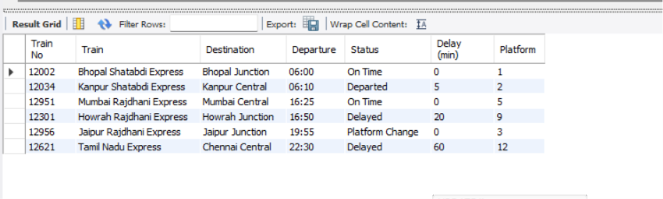

<div align="center">

# 🚆 Railway Station Display-Board System (SQL)

**A small MySQL model of a station display board, built around one idea: a single source of truth.**




</div>

---

## 📌 Overview

I was waiting at a railway station, staring at the display board. Trains coming, going, getting delayed, platforms changing every minute. I started wondering how it works behind the scenes, so I built a small version of it in SQL. Nothing fancy, just enough to understand it.

### The one idea I took away

When a train gets delayed, you don't update the board, the app and the website separately. You keep the status in **one place** and let all of them read from it. Change it once and everything updates together.

That one table, `live_status`, is the single source of truth.

## 🗂️ Data Model

| Table | What it holds |
|---|---|
| `stations` | Station code, name, city, state |
| `train_master` | Train number, name, source and destination station |
| `train_schedule` | Planned timetable: each stop of each train |
| `live_status` | Live status, delay and expected platform (**the source of truth**) |
| `platform_status` | Which platform is occupied right now, and by which train |

Tables are linked with foreign keys. The display board is a `JOIN` across these tables; no screen keeps its own copy of the data.

## 🔍 Queries

| # | Query | What it shows |
|---|---|---|
| Q1 | Display board at New Delhi | Train, destination, departure, status, delay, platform |
| Q2 | Delay one train | `UPDATE` one row in `live_status`, re-run Q1 and the board reflects it |
| Q3 | Free platforms at New Delhi | `CASE` on `platform_status` |
| Q4 | Delayed trains only | What an alerts job would read |

### The part I liked

Say Tamil Nadu Express is running late. I don't touch the whole database, I change one row:

```sql
UPDATE live_status
SET current_status = 'Delayed', delay_minutes = 60
WHERE train_id = (SELECT train_id FROM train_master WHERE train_number = '12621');
```

Run the display-board query again and the delay is already there. One change, and every screen reading that table is in sync.

## 💡 How did this work before computers?

In my project I update that row by hand. In the real system, a GPS device on each train sends its location and a program updates the row on its own. Before GPS, a person in the control room updated a big paper chart as each station phoned in where the trains were. That chart was the single source of truth back then.

The idea never changed, only who does the updating. A station master became a GPS, and a paper chart became a table. The same idea powers modern operational dashboards.

## 📁 Repository Structure

```
railway-sql-display-board/
├── sql/
│   ├── schema.sql          # creates the database, tables and sample data (run first)
│   └── queries.sql         # display board, one-row update, platforms, delays
├── data/                   # the same sample data as CSV files
│   ├── stations.csv
│   ├── train_master.csv
│   ├── train_schedule.csv
│   ├── live_status.csv
│   └── platform_status.csv
├── images/
│   └── display-board-output.png
└── README.md
```

## ▶️ How to Run

1. Open `sql/schema.sql` in MySQL Workbench and run it. It creates everything.
2. Open `sql/queries.sql` and run the queries one by one.

> **Note:** the data is sample data I made up, using real Indian train and station names, to test the design.

---

## 👤 Author

**Abhishek Kumar** · MIS Data Analyst  
[LinkedIn](https://www.linkedin.com/in/abhikumar8762/) · [GitHub](https://github.com/abhishek8762a) · [Portfolio](https://abhishek-portfolio-8762.vercel.app) · [Email](mailto:abhiyadav8762@gmail.com)
